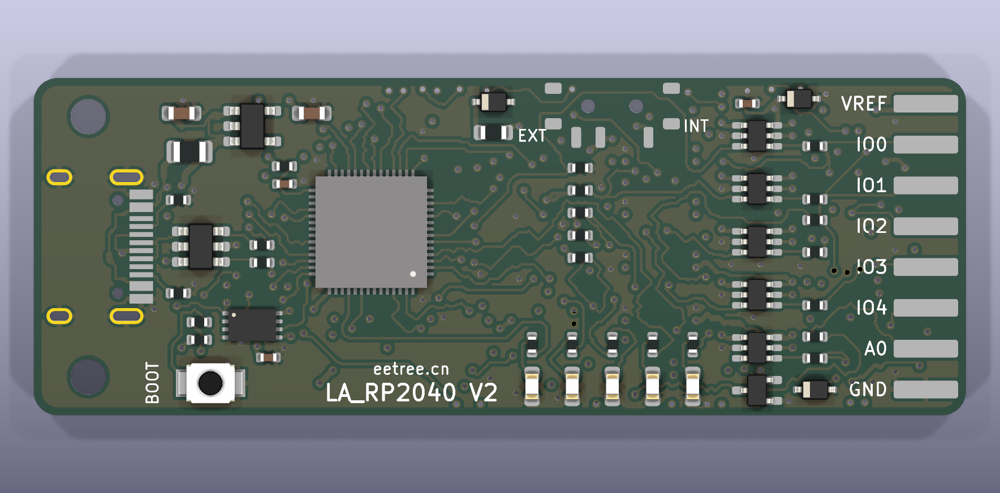
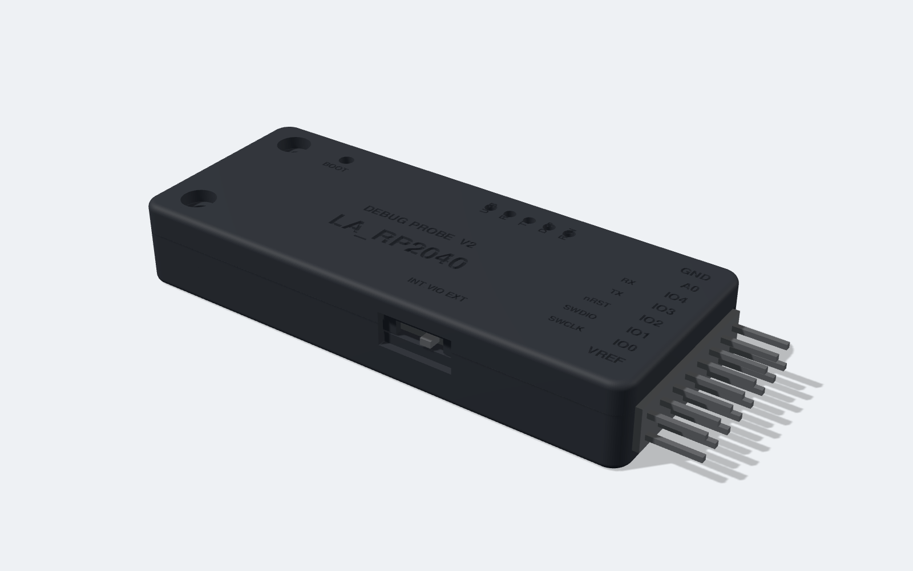

# LA_RP2040 V2 多功能调试器（硬件）

基于 RP2040 的 SWD 调试 + 串口 + 8 通道逻辑分析 + 3 路 ADC 调试器的第二版硬件。相对 V1（`dist/hardware/rp2040/source`）的改动：

| 项目 | V1 | V2 |
|---|---|---|
| USB-C | Type-C 直连不枚举 | 重新设计输入级，见下文「V1 问题分析」 |
| 管脚分配 | GP20–GP28 自定义 | 与 Raspberry Pi Debug Probe 完全一致，官方 `debugprobe` 固件可直接使用 |
| 电平转换 | 无，仅 3.3 V | 8 路 74LVC1T45，目标侧 1.65–5.5 V，方向可控（IO0–IO4 独立，IO5–IO7 共用） |
| 端口保护 | 无 | TVS 阵列 + 串联电阻 + 断电高阻（Ioff）+ 自恢复保险丝 + 防倒灌二极管，ADC 输入钳位 |
| 接口 | 2×6（12 Pin） | 2×8（16 Pin），带 VTREF、3 路模拟输入、+5 V 输出 |
| 电源 | SGM6012 Buck | AP2112K-3.3 LDO（与官方 Probe 相同） |
| PCB | 2 层 35 × 16.5 mm | 4 层 58 × 21 mm，内层完整 GND / 3V3 平面 |
| 外壳 | 无 | 上下两件式外壳（STEP / STL） |

> **状态：设计文件已通过 KiCad 9.0.9 的 ERC / DRC（结果见「验证」），没有打样和实物测试。** 投板前请按文末「投板前检查清单」核对。





## 目录

```
kicad/      KiCad 9 工程（原理图、PCB、工程文件、J2 封装库）
fab/        Gerber + 钻孔 zip、贴片坐标、BOM、板子 STEP
doc/        原理图 PDF/SVG、PCB 各层 SVG/PDF、渲染图
enclosure/  外壳 CadQuery 源码、STEP、STL、视图
gen/        生成脚本：design.py 是唯一数据源（器件、网表、布局）
```

原理图和 PCB 都由 `gen/design.py` 生成，因此二者不会不一致。改动器件位置后需要 `gen/build.sh route` 重新布线；布线器对同一布局的结果是确定的，但布局变动后可能有个别连接布不通，需要调整 `ROUTE_ORDER` / `ROUTE_LAYER_COST` 或局部布局。可以直接用 KiCad 打开 `kicad/LA_RP2040_V2.kicad_pro` 手工修改；但重新运行 `gen/build.sh` 会覆盖手工改动，需要长期保留的修改请写进 `gen/design.py`。

## V1 问题分析：USB-C 直连找不到设备，A-to-C 线正常

A-to-C 线的 VBUS 是常通的；C-to-C 时主机必须先在 CC 线上检测到设备的 5.1 kΩ 下拉（Rd）才会打开 VBUS。因此这个现象说明**主机没有检测到有效的 Rd，或者 VBUS 打开之后板子没有正常起来**。

对 V1 工程文件的检查结果：

- 网表上 CC1（A5）→ R5 5.1 kΩ → GND，CC2（B5）→ R6 5.1 kΩ → GND，各自独立，接法正确；KiCad DRC 报告 0 个未连接项，说明走线和网表一致。**所以 V1 的原理图本身不是原因**，我无法仅凭设计文件确定实物上的根因。
- 实物上可疑的地方：
  1. R5 / R6 用的是 **0201** 封装，紧贴 USB 座的 0.3 mm 细焊盘。贴片虚焊、立碑或者物料贴错（例如 51 kΩ / 5.1 Ω）都会让 CC 检测失败，而 A-to-C 线下完全不受影响。
  2. C-to-C 主机的 VBUS 带软启动，上升比 A 口慢。V1 用 Buck（SGM6012，EN 直接接 VIN），慢上升时 3V3 可能不单调；V1 的晶振没有 XOUT 串联电阻，RUN 没有外部上拉，Flash CS 没有上拉，启动裕量都偏小。
- 建议在 V1 板上验证：断电量 CC1、CC2 对 GND 的电阻（应各为 5.1 kΩ）；C-to-C 连接时量 VBUS 是否有 5 V；有 5 V 再看 3V3 的上电波形。

V2 的对应措施：CC1 / CC2 各用一颗 **0402 1% 5.1 kΩ**（R1、R2）；电源改为 LDO；XOUT 加 1 kΩ（R6）；RUN 加 10 kΩ 上拉（R9）；QSPI_SS 加 10 kΩ 上拉（R8）；VBUS 加自恢复保险丝（F1）和 USBLC6-2SC6（U1）。

## 管脚分配（兼容官方 Debug Probe 固件）

官方 `debugprobe` 固件（`board_debug_probe_config.h`）用到的管脚全部保持一致：

| RP2040 | 官方 Probe 功能 | V2 网络 |
|---|---|---|
| GP2 | USB 已连接 LED（红） | D1 |
| GP4 / GP5 | UART1 TX / RX | IO3 / IO4 |
| GP7 / GP8 | UART RX / TX LED | D2 / D3 |
| GP12 | SWCLK | IO0 |
| GP13 | SWDIO 输入（SWDI） | IO1（经输入缓冲 U7） |
| GP14 | SWDIO 输出 | IO1（经输出缓冲 U6 + 470 Ω） |
| GP15 / GP16 | DAP 已连接 / 运行 LED | D4 / D5 |

官方固件不使用的管脚用于扩展功能：

| RP2040 | V2 功能 |
|---|---|
| GP20, GP23, GP24, GP25 | IO2、IO5、IO6、IO7 的 3.3 V 侧数据 |
| GP18, GP19, GP21, GP22, GP9 | DIR0–DIR4：IO0–IO4 的方向，高 = 输出到目标 |
| GP10 | DIR567：IO5–IO7 共用的方向 |
| GP26, GP27, GP28 | ADC0–ADC2（A0–A2） |
| GP29 | VIO 电压检测（100 k / 100 k 分压，VIO = 2 × ADC3） |
| GP0, GP1, GP3, GP6, GP11, GP17 | 未使用 |

8 路 IO 在 RP2040 上对应 GP12、GP13、GP20、GP4、GP5、GP23、GP24、GP25，**不是连续管脚**。这是为了让 0.4 mm 间距的 QFN 能在普通 4 层板工艺下扇出而做的取舍：逻辑分析固件需要一次读入全部 GPIO 再按位重排，不能直接用 PIO 的连续 8 脚采样。

DIR 线的默认值由电阻决定，官方固件不驱动这些脚时：IO0（SWCLK）、IO1 输出驱动、IO3（TX）为输出，其余为输入。

## 16 Pin 目标接口（J2，2×8，2.54 mm，板边夹装）

奇数脚在正面，偶数脚在背面，1 脚靠近 VIO 拨动开关一侧。

| 正面 | 功能 | 背面 | 功能 |
|---|---|---|---|
| 1 | VREF：目标参考电压（EXT 输入 / INT 输出约 3.0 V） | 2 | GND |
| 3 | IO0：SWCLK / LA D0 | 4 | IO5：LA D5 |
| 5 | IO1：SWDIO / LA D1 | 6 | IO6：LA D6 |
| 7 | IO2：nRESET（预留）/ LA D2 | 8 | IO7：LA D7 |
| 9 | IO3：UART TX（调试器输出）/ LA D3 | 10 | GND |
| 11 | IO4：UART RX（调试器输入）/ LA D4 | 12 | A1：ADC1 |
| 13 | A0：ADC0 | 14 | A2：ADC2 |
| 15 | GND | 16 | +5V 输出（约 4.6 V，350 mA 保险丝） |

只做 SWD + 串口调试时，只需要正面一排：VREF、SWCLK、SWDIO、(nRESET)、TX、RX、GND。

## 电平转换

每一路是：接口脚 → TVS → 100 Ω → 74LVC1T45 的 B 侧（VCCB = VIO）→ A 侧（VCCA = 3V3）→ RP2040。74LVC1T45 两侧都支持 1.65–5.5 V，任一侧断电时端口高阻（Ioff），所以目标板未上电时不会被调试器倒灌，调试器未上电时也不会被目标板倒灌。

**SWDIO 与官方固件的兼容方式。** 官方固件只通过 GP14 的输出使能切换方向，没有单独的方向信号，而 74LVC1T45 需要 DIR。V2 的做法是把 SWDIO 拆成两路：

- 输出：GP14（10 kΩ 上拉）→ U6（DIR1 默认高，常驱动）→ **470 Ω** → IO1。
- 输入：IO1 → 100 Ω → U7（方向固定为输入）→ GP13。

官方固件释放 GP14 时，U6 经 470 Ω 把线拉高，目标驱动低电平时要多灌入 VIO / 470 Ω 的电流（3.3 V 时约 7 mA，1.8 V 时约 3.8 mA），读回走 U7。这相当于一个 470 Ω 的强上拉，协议上没有问题，代价是目标 SWDIO 的低电平输出电流变大、边沿时间常数约 25 ns（按 50 pF 负载估算）。弱驱动能力的目标（例如某些 MCU 的标准驱动档）请降低 SWD 时钟或改用下面的方式。

如果固件在读阶段把 DIR1（GP19）拉低（上游 debugprobe 的 `PROBE_IO_OEN` 模式就是这样工作的，需要自己编译），U6 的目标侧变为高阻，就没有上述额外电流。硬件已经为此留好。

## 端口保护（参考 Microchip Nano Debugger 的做法）

Microchip 参考设计的要点是：每个信号一颗 1T45 且方向由 MCU 控制、目标侧加下拉确定空闲电平、目标电压可检测、电源输入限流。V2 对应实现并补充了 ESD 器件：

| 位置 | 措施 |
|---|---|
| IO0–IO7 | SRV05-4 TVS 阵列（U14、U15）→ 串联电阻 → 74LVC1T45；目标侧 100 kΩ 上/下拉确定空闲电平 |
| VREF | SOD-323 TVS（D7）；INT 模式下 3V3 经肖特基 D6（防目标高压倒灌 3V3）和 200 mA 保险丝 F2 输出 |
| +5V 输出 | 肖特基 D8（防倒灌到 USB 主机）+ 350 mA 保险丝 F3 + TVS D9 |
| A0–A2 | 2.2 kΩ 串联 + BAT54S 钳位到 GND / 3V3；量程 0–3.3 V |
| USB | USBLC6-2SC6（D+ / D− / VBUS）、500 mA 保险丝 F1、27 Ω 串联电阻 |

量程和限制：IO 脚工作电压 0–5.5 V；VREF 建议不超过 5.25 V（TVS 的截止电压为 5 V）；模拟输入超过 3.3 V 会被钳位，不要长期接高于 5 V 的电压。TVS 只针对静电和瞬态，不能承受持续过压。

## VIO 选择开关（SW2）

- **INT**：调试器用自己的 3V3 给电平转换供电，VREF 脚输出约 3.0 V（肖特基压降），可给小负载供电，受 F2 限制。适合目标是 3.3 V 且没有引出 VTREF 的场合，用法与官方 Probe 相同。
- **EXT**：电平转换由目标的 VREF 供电（1.65–5.5 V）。VREF 没接时所有输出高阻。

## PCB

- 58 × 21 mm，4 层，1.6 mm。F.Cu / B.Cu 走信号并铺 GND；In1 是 GND 层；In2 是 3V3 铺铜与信号混用层。
- 规则：线宽 / 间距 0.15 / 0.15 mm，过孔 0.55 / 0.3 mm，铜到板边 ≥ 0.3 mm，普通 4 层工艺即可，不需要盲埋孔。
- 器件 113 个，正反两面贴片，最小封装 0402、QFN-56（0.4 mm）、USON-8。
- 位号只放在 Fab 层；丝印只保留接口脚名、开关和版本信息。
- 两个 M2 安装孔在 USB 端，J2 是自建封装（`kicad/LA_RP2040_V2.pretty`）。
- RP2040 电源脚和电平转换器的扇出是按规则预先确定的（`design.py` 里的 `PRE_VIAS` / `PRE_LINKS`），其余走线由 `gen/route.py`（网格 A* 自动布线 + 有界回溯拆线重布）完成，最后由 KiCad DRC 检查。

**自动布线的局限，请在投板前评估：**

- 走线没有经过人工优化，折线多、过孔多，形态不如手工布线。
- 为了布通，相当一部分信号借用了内层：In2 上有大量信号线，In1（GND 层）上也有少量走线，所以**两个内层都不是完整平面**。GND 的连通由 In1 铺铜、正反面 GND 铺铜和过孔共同保证；3V3 的连通由 In2 铺铜加上显式的连接线保证（DRC 的连通性检查覆盖这两个网络）。
- 对这块板的信号速率（SWD 几 MHz、USB 全速 12 Mbps、ADC 500 kSa/s）这通常可以工作，但回流路径和抗干扰不如完整地平面。如果要作为正式产品量产，建议以这份布局和网表为起点，在 KiCad 里人工重布内层被占用的部分，恢复完整的 GND 平面。
- USB D+ / D− 没有做差分等长和阻抗控制。

## 外壳

`enclosure/enclosure.py`（CadQuery）根据 `design.py` 里的板子尺寸和器件位置生成：

- 外形 61.4 × 24.7 × 10.1 mm，上盖 + 底壳，四周止口搭接，USB 端两颗 M2×8 自攻螺丝穿过 PCB 安装孔锁紧，排针端靠两侧卡扣和上盖压柱固定。
- 开口：USB-C、2×8 排针、VIO 拨动开关（侧面带指槽）、5 个 LED 孔、BOOT 针孔。
- 上盖刻有管脚名和功能，底壳刻有背面一排的管脚名。
- 输出 `LA_RP2040_V2_lid/tray.step/.stl`；渲染图在 `doc/enclosure_*.png`（图中的 PCB 和连接器是占位模型）。设置 `ENCLOSURE_FULL=1` 可额外导出装配体 STEP 和线框视图。壁厚 1.6 mm（USB 端 1.2 mm），按 FDM / 光固化 3D 打印设计；开模注塑需要另加拔模斜度。

## 固件

三种固件都有 V2 版本，在工作台的「RP2040 固件」页下载，或用 `python firmware/build.py --board v2` 构建。细节见 [`docs/RP2040.md`](../../docs/RP2040.md)。**固件只做了交叉编译和主机侧测试，没有在实板上运行过。**

- **`la-rp2040-v2-dap.uf2`**：上游 debugprobe 的 Debug Probe 配置，外加经电平转换的 nRESET（IO2）。官方 `debugprobe.uf2` 也可以直接使用，只是没有 nRESET。
- **`la-rp2040-v2-sump8.uf2`**：8 通道逻辑分析。因为 8 路不在连续管脚上，每个采样存 32 位，深度为 50000 点。
- **`la-rp2040-v2-adc12.uf2`**：ADC 采集，协议与 V1 相同。
- V1 固件不能刷到 V2 上使用：V1 把信号放在 GP20–GP28，而 V2 的这些脚接的是方向控制线和 IO2。
- 网页工作台默认显示 V2 的接线；连接运行 V1 固件的板子时会按 USB 产品名切换到 V1。

## 重新生成

需要 Python 3 + numpy、Docker（`kicad/kicad:9.0` 官方镜像）；外壳需要 `pip install cadquery`。

```bash
gen/build.sh            # 原理图 → 网表核对 → 布局 → 载入已保存的布线（gen/routes.json）→ 铺铜 → ERC / DRC
gen/build.sh route      # 先重新自动布线并修补连通性（15–30 分钟），再执行上面的流程
gen/export_fab.sh       # Gerber、钻孔、坐标、BOM、PDF、SVG、STEP
python3 enclosure/enclosure.py enclosure
```

## 验证

见 [`doc/VERIFICATION.md`](doc/VERIFICATION.md)。

## 投板前检查清单

以下项目没有实物验证，或依赖我无法在线核对的数据手册：

1. **USB-C 座**：封装为 HRO TYPE-C-31-M-12，板边位置按连接器前端伸出板边 1.0 mm 设定。请对照所购型号的规格书确认伸出量和定位柱孔位，外壳 USB 开口也依赖这个尺寸。
2. **拨动开关 MSK-12C02**：确认拨杆伸出长度；设计中拨杆尖端大约与外壳指槽底面平齐。
3. **排针夹装**：2×8 直排针夹在 1.6 mm 板边焊接，焊盘 4 × 1.1 mm，与 V1 的做法相同。
4. **保险丝和 TVS 的具体型号**在 BOM 里给的是规格和示例料号，请按供应商库存选型；D7 / D9 需要 5 V 截止电压的器件。
5. **SWDIO 470 Ω 方案**的最高 SWD 速率需要实测，建议从 1 MHz 开始。
6. **LED 限流 470 Ω** 沿用官方 Probe 的取值，绿光 LED 在 3.3 V 下会比较暗，可按实际亮度调整。
7. **外壳公差**：止口间隙 0.12 mm、PCB 四周间隙 0.25 mm，需按打印工艺试装后调整。
8. 内层平面不完整（见「PCB」一节），ADC 的噪声和 SWD 的最高速率需要实测。
